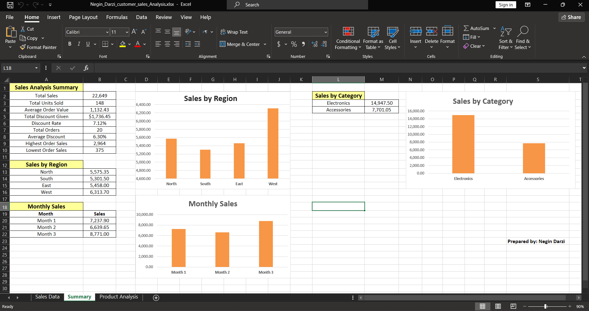

Customer & Sales Analysis Using Microsoft Excel

Author: Negin Darzi

Project Overview

This project demonstrates the use of Microsoft Excel to analyze customer and sales data, evaluate product performance, and summarize key business metrics. It focuses on transforming raw sales records into meaningful insights that can support business decision-making.

Project Objectives

- Analyze overall sales performance.
- Identify the top 5 products by total sales.
- Compare sales performance across regions and product categories.
- Analyze monthly sales trends.
- Evaluate discounts, order values, and units sold.
- Practice Excel formulas and data visualization for business analysis.

Workbook Structure

1. Sales Data

Contains 20 order records, including product names, categories, regions, units sold, unit prices, discounts, and calculated sales values.

2. Summary Dashboard

Provides an overview of key performance indicators (KPIs), including:

- Total sales and units sold
- Average order value
- Total discounts and average discount rate
- Highest and lowest order sales
- Sales by region and product category
- Monthly sales performance

3. Product Analysis

Identifies and compares the top 5 products based on total sales, helping highlight the best-performing products in the dataset.
## Dashboard Preview

Tools & Techniques

- Microsoft Excel
- Excel formulas and calculations
- SUM, SUMIF, AVERAGE, MAX, MIN, and COUNTA
- Sales and product performance analysis
- KPI summaries and charts
- Data visualization

Key Skills Demonstrated

- Data organization and spreadsheet management
- Business and sales analysis
- Performance measurement
- Analytical thinking
- Data-driven decision-making

Project Purpose

This project was developed as a practical portfolio project to strengthen my Excel skills and apply business analysis concepts relevant to Business Administration, Sales, and Marketing.

---

Created by Negin Darzi
